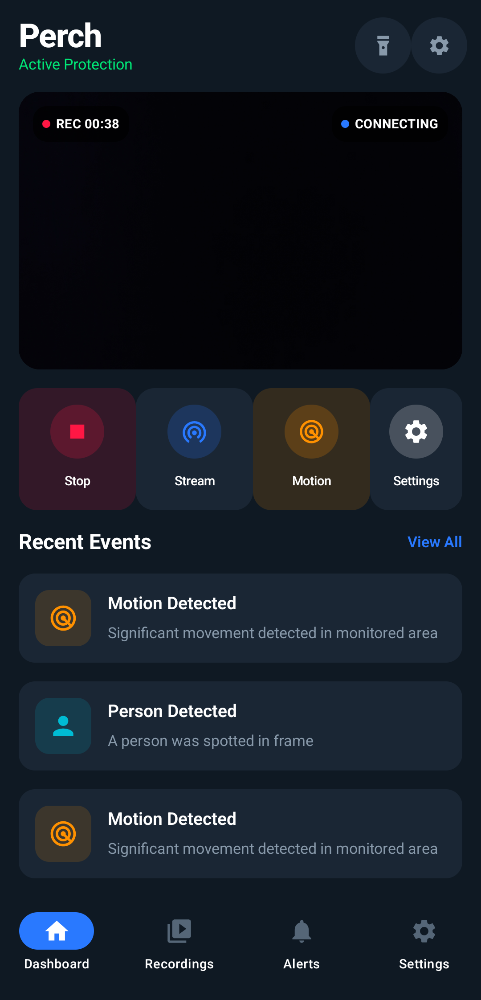
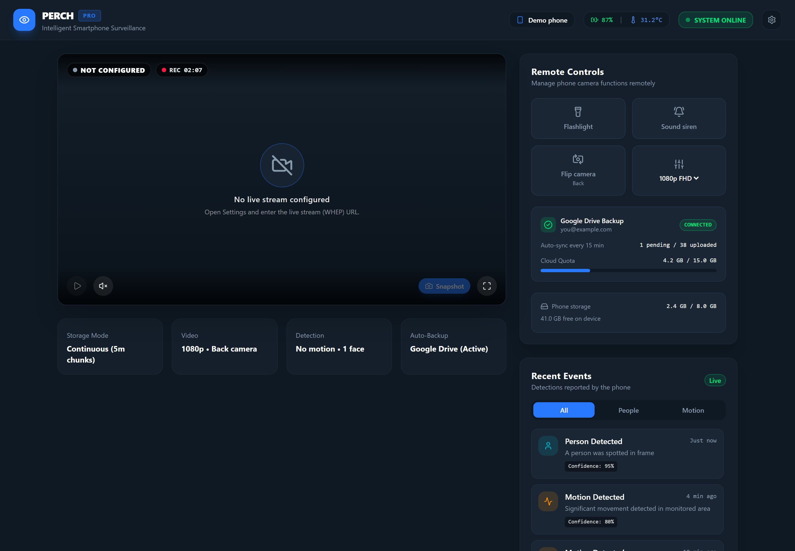
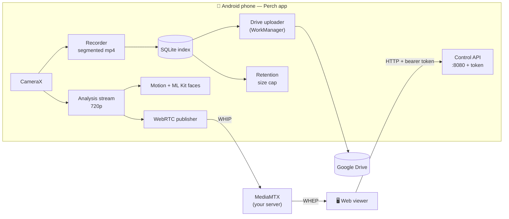

<div align="center">

# 🦉 Perch

**Turn an old Android phone into an always-on security camera.**
Live view in any browser, on-device face and motion detection, automatic Google Drive backup — no subscription, no Perch cloud.

[](https://github.com/ayrball/perch/actions/workflows/ci.yml)


<br>


&nbsp;&nbsp;


<sub>Left: the app on a Pixel 10a while recording. Right: the web viewer, shown with demo data from a mock phone.</sub>

</div>

---

## Why Perch

Most "turn your old phone into a camera" apps either stream through someone's cloud or stop working the moment the screen turns off. Perch is built for the phone that sits on a shelf for months:

- **It keeps recording with the screen off.** A foreground service holds the camera, a CPU wake lock and a high-performance Wi-Fi lock. Video is cut into 5/10/15/30-minute segments so a crash never costs more than one chunk.
- **It never fills the phone.** Local recordings are capped (default 8 GB). Uploaded copies can be deleted automatically; if the cap is hit, already-backed-up footage goes first, then the oldest un-backed-up footage.
- **It protects the battery.** Above 45 °C it drops to 720p, scans for faces less often and slows the stream, then returns to normal below 41 °C.
- **It recovers.** If another app grabs the camera, or the camera stays open but stops delivering frames, Perch detects it and re-binds instead of silently recording nothing.
- **Your footage stays yours.** Detection runs on the phone. Streaming goes to a server *you* run. Backup goes to *your* Google Drive and Perch can only see the files it created.

## Features

| | |
|---|---|
| 🎥 **24/7 recording** | Segmented mp4, ~6 Mbps at 1080p (≈45 MB/min), 720p / 1080p / 4K |
| 🌐 **Live view** | WebRTC (WHIP → [MediaMTX](https://github.com/bluenviron/mediamtx) → WHEP) to any browser, with face boxes and a motion badge drawn from real detections |
| 🧠 **On-device AI** | Google ML Kit face detection + frame-differencing motion detection, with alert cooldowns and optional push notifications |
| ☁️ **Google Drive backup** | WorkManager uploads, Wi-Fi-only by default, real sign-in verification, a notification if access is revoked or Drive is full |
| 🎛️ **Remote controls** | Flashlight, siren, flip camera and video quality from the web viewer through a token-protected API on the phone (off by default) |
| 🔁 **Boot / restart handling** | Auto-resume where Android allows it, a "tap to resume" notification where it doesn't |

## How it fits together



## Quick start

**1. The phone** — open `android/` in Android Studio (JDK 17–21), run it on a device, grant Camera / Microphone / Notifications and exempt Perch from battery optimization. Everything below is optional and lives in **Settings**:

- **Cloud Backup** → *Connect Google Drive* (one-time Google Cloud setup: [docs/GOOGLE_DRIVE_SETUP.md](docs/GOOGLE_DRIVE_SETUP.md))
- **Live Streaming** → your MediaMTX address ([docs/STREAMING_SETUP.md](docs/STREAMING_SETUP.md))
- **Remote Control** → switch on, note the address and token ([docs/CONTROL_API.md](docs/CONTROL_API.md))

**2. The viewer**

```bash
cd web-viewer
npm install
npm run dev        # http://localhost:3000
```

On first launch it asks for the phone's address, the token and the stream URL, and keeps them in your browser's local storage.

## Documentation

| | |
|---|---|
| [Streaming setup](docs/STREAMING_SETUP.md) | Run MediaMTX, point the phone at it, troubleshoot |
| [Control API](docs/CONTROL_API.md) | Every endpoint, the status JSON, the security model |
| [Google Drive setup](docs/GOOGLE_DRIVE_SETUP.md) | Google Cloud project, OAuth client, how backup behaves |
| [Testing](docs/TESTING.md) | What is covered, what was checked on a real phone, how to run it all |

## Tested, honestly

**267 automated tests** — 67 Android unit, 28 on-device (instrumented), 172 web — plus a manual pass on a real **Pixel 10a (Android 16)**: database upgrade, segment rollover, camera flip, thermal throttling (fake 46 °C battery), another app taking the camera, Stop while the app is open, starting without the microphone, 480 concurrent API calls, and the WebRTC offer reaching a server. Details and the exact scenarios are in [docs/TESTING.md](docs/TESTING.md).

**Not yet verified end to end:** the live video path against a real MediaMTX server, and the Google sign-in flow (both need infrastructure/accounts the test pass didn't have). The logic around them is tested; the full round trip is the next thing to try.

## Known limits

- The stream is **video only** (recordings include audio).
- Streaming and remote control work on your **local network**; use a VPN (Tailscale, WireGuard) from outside. Nothing here is meant to be exposed to the internet.
- Face detection finds and counts faces; it doesn't identify people (`FACE_RECOGNIZED` is reserved).
- Tapping a recording in the app doesn't play it yet — recordings are listed with their upload state.
- A killed process loses the segment being written (at most one chunk).

## Repository layout

```
perch/
├── android/            Kotlin + Jetpack Compose app (package com.perch.cam)
│   └── app/src/main/java/com/perch/cam/
│       ├── camera/     CameraEngine (preview, recording, analysis, watchdog), SegmentedRecorder
│       ├── detection/  MotionDetector, FaceDetector, AlertManager
│       ├── service/    RecordingService — the 24/7 foreground service
│       ├── streaming/  WebRTCPublisher, WhipClient, I420Converter, FrameRateLimiter
│       ├── control/    ControlApi, ControlServer, SirenPlayer
│       ├── backup/     Drive helper, connector, upload worker, scheduler
│       ├── storage/    RetentionPlanner / RetentionManager
│       ├── data/       SQLite database + migrations, preferences
│       └── ui/         Compose screens and theme
├── web-viewer/         React 19 + TypeScript + Vite + Tailwind dashboard
└── docs/               Setup guides, API reference, testing notes
```

## Hardware tips for a phone that never sleeps

1. **Smart plug** — cycle power between roughly 20 % and 80 % battery so a permanently charging cell doesn't swell.
2. **Airflow** — heat is the main enemy; mount it where air can move.
3. **Screen** — turn brightness to minimum or let it sleep; recording continues either way.

## License

Licensed under the [PolyForm Noncommercial License 1.0.0](LICENSE). You are free to use, modify and share this for personal, hobby, educational, research and other noncommercial purposes.

**Commercial use** (selling it, building a paid product or service on it, or using it in a business) needs a separate license from the author. Commercial licenses are available: get in touch via [github.com/ayrball](https://github.com/ayrball) to discuss terms.
